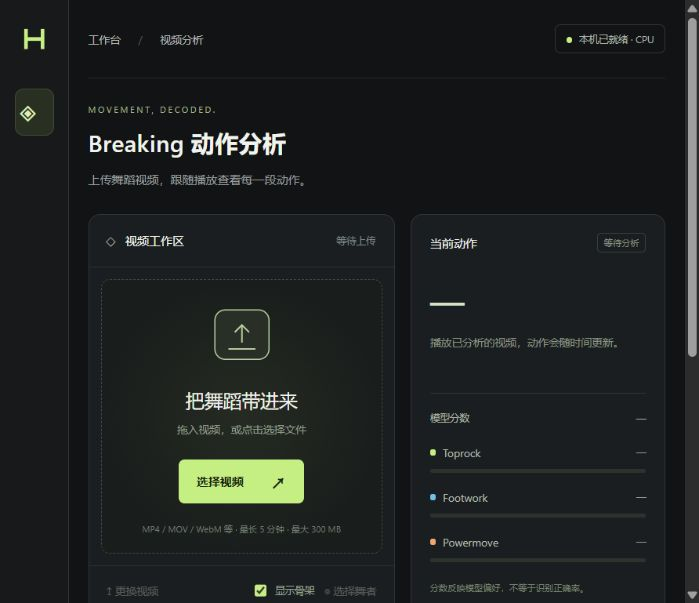

# HyperDance

上传街舞视频，在本地浏览器中查看 **Toprock、Footwork、Powermove** 动作时间线和骨架分析。包含 Windows 本地网站、ST-GCN 训练代码，以及 AIST++ / BRACE 研究实验。



## 当前能力

- RTMPose 提取 COCO 17 点骨架，ST-GCN ONNX 模型识别 Breaking 三类动作。
- 视频上传后后台分析，随播放时间显示预测与时间线，支持结果导出。
- CPU 本地推理，视频保存在本机，提供启发式不确定状态提示。
- AIST++ 十舞种研究模型已经训练，暂未接入网站。

当前网站面向单人 Breaking 视频。Freeze、非 Breaking、遮挡、多人画面尚未充分覆盖。置信度未经概率校准，处理速度取决于电脑配置；本项目仍是研究原型。

## 研究结果

以下均为**验证集**结果，单种子 42，测试集尚未评估。来源级结果汇总同一来源的窗口，不能代替逐时刻识别指标。

| 实验 | 窗口平均类别准确率 | 窗口宏 F1 | 来源平均类别准确率 |
|---|---:|---:|---:|
| AIST++ V1 | 74.22% | 72.02% | 79.33% |
| AIST++ V2 A | 73.26% | 70.72% | 78.96% |
| BRACE V1（网站使用） | 81.84% | 81.63% | 91.37% |
| BRACE V2 B | 82.04% | 82.14% | 91.71% |

V2 未显示明确整体提升，网站保留 V1 BRACE。Footwork 与 Powermove 仍有混淆；Popping 的跨舞者泛化较差，目前优先研究 Breaking。

[实验说明](docs/RESEARCH.md) · [完整指标与图表](research/results) · [数据准备](docs/DATASETS.md) · [复现说明](docs/REPRODUCIBILITY.md)

## 本地运行

先按 [Windows 安装说明](docs/SETUP.md)准备部署包与依赖。仓库不附模型权重，仅克隆源码无法执行识别。

```bat
setup_local.bat
start_local.bat
```

打开 http://127.0.0.1:8000 ，保持启动窗口开启。端口占用时先尝试打开该地址，可能已有实例运行。

## 目录

- `web/`：FastAPI 后端与浏览器界面。
- `dance_core/`、`dance_mm/`：共用预处理与 MMAction2 自定义变换。
- `training/`：数据校验、训练配置、分析和导出脚本。
- `research/results/`：验证指标、训练曲线、混淆矩阵。
- `tools/`：姿态模型下载和 GPU 启动工具。

数据集、权重、上传视频、环境和服务器连接信息不纳入仓库。使用须遵循[第三方许可](THIRD_PARTY.md)。
